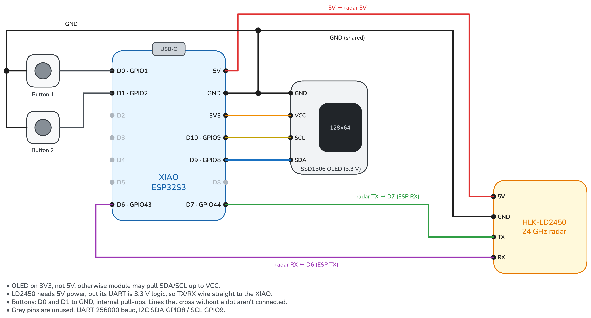

# HomelabRadar

An mmWave presence sensor for Home Assistant, built with ESPHome. An HLK-LD2450 radar tracks up to 3 people. A 0.96" OLED shows them live, and a push button switches between views.

## Hardware
- Seeed Studio XIAO ESP32S3, with a 2.4 GHz U.FL antenna (the board has no onboard antenna)
- HLK-LD2450 24 GHz radar
- 0.96" SSD1306 OLED, 128×64, I2C
- 2 momentary push buttons

## Wiring


The XIAO is drawn from the component side with USB-C at the top. Button 2 (D1) is wired but not used in the firmware yet. To edit the diagram, open `docs/wiring.excalidraw` at https://draw.lab.richter.codes, then use Export image → PNG to replace `RadarDiagram.png`.

| XIAO pin | Connects to |
|---|---|
| 5V | LD2450 5V |
| GND | LD2450 GND, OLED GND, both buttons |
| D7 (GPIO44) | LD2450 TX |
| D6 (GPIO43) | LD2450 RX |
| 3V3 | OLED VCC |
| D9 (GPIO8) | OLED SDA |
| D10 (GPIO9) | OLED SCL |
| D0 (GPIO1) | Button 1 (other leg to GND; uses the internal pull-up) |
| D1 (GPIO2) | Button 2 (other leg to GND; not in the firmware yet) |

The LD2450 runs on 5 V, but its UART uses 3.3 V logic, so it connects directly. Power the OLED from 3V3, not 5V. Many modules pull SDA/SCL up to their VCC.

Mount the radar with its long edge vertical and the antenna side (no connector) facing the room, 1.5–2 m high. It covers ±60° horizontally and up to 6 m.

## Display
- **Short press:** next view.
- **Hold 1 s:** screen off. Any press turns it back on.

| View | Shows |
|---|---|
| Map | Top-down cone with 5/10/15/20 ft rings and a dot per person |
| Status | "1 person" / "2 people" / "Clear" in large text, plus nearest distance |
| Targets | One row per person: X (L/R) and Y in ft, and angle |

Left and right are drawn as seen by someone facing the radar. Set `x_sign: "1"` to use the radar's own view instead.

## Behavior
- **Radar settings at boot:** the firmware turns the LD2450's Bluetooth off, since any nearby phone could otherwise reconfigure it. It also sets a filter zone that ignores anything within ~2 ft of the radar.
- **Home Assistant entities:** Presence, Target Count, Nearest Distance (ft, at most once a second), a Radar Bluetooth switch and Presence Timeout.
- **Raw positions stay on the device.** X/Y positions update ~10×/s for the display and aren't sent to Home Assistant.

## Build and flash
```sh
brew install esphome
cp secrets.yaml.example secrets.yaml   # fill in Wi-Fi and generate the keys
esphome run radar.yaml                  # first time over USB, then over Wi-Fi
```

The default LD2450 sensor filters in ESPHome 2026.10 throttle updates to once a second. This config overrides them so the display keeps up with the radar's ~10 Hz frames.
